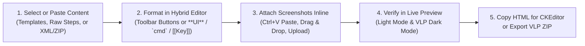

# VLP Manual HTML Formatter & XML Builder

## About

**VLP Manual HTML Formatter & XML Builder** is a self-contained, air-gapped authoring studio built for **VMware Lab Platform (VLP)** instructors and technical manual developers. VLP's rich-text CKEditor frequently injects incompatible Word/Office inline styles, breaks dark-mode contrast with opaque table/list backgrounds, and scatters micro-steps across dozens of legacy XML nodes.

This application converts raw text, draft notes, and legacy `content.xml` chapters into standardized, light-and-dark-mode compatible HTML5 snippets (`</> Source` ready) or complete VLP `.zip` archives (`content.xml` + `images/`)—running 100% natively without AI tools or external internet access.

## Release & Pre-Packaged Docker Image (`beta 0.3.4`)

- **Container Registry Image (Pull Directly)**: `docker pull ghcr.io/balbyyo/vlp-manual-generator:latest` (also tagged `0.3.4-beta`)
- **GitHub Release (`beta 0.3.4`)**: [v0.3.4-beta Release Page](https://github.com/BalbyyO/VLP-manual-generator/releases/tag/v0.3.4-beta)
- **Direct Packaged Docker Image Download (`.tar`)**: [vlp-manual-generator-0.3.4-beta.tar](https://github.com/BalbyyO/VLP-manual-generator/releases/download/v0.3.4-beta/vlp-manual-generator-0.3.4-beta.tar)

---

## Key Features

- **100% Native & Air-Gapped**: Deterministic formatting engine (`public/vlp-formatter.js`) with zero external CDNs, fonts, or AI dependencies.
- **VLP Split-Screen Scaling & Light/Dark Contrast Isolation**: Master `<style>` uses `table-layout: fixed`, container queries (`@container vlp-manual`), and responsive image/code wrapping so screenshots and data tables fit cleanly inside VLP's 1/3 or 1/2 right-hand taskbar without horizontal clipping, while isolating Light Mode `.theme-light` / `clr-theme="light"` `.step-context` colors from OS dark-mode overrides.
- **Dark-First UI + High-Contrast Light Mode**: Opens in **Dark Mode** by default for both the Studio UI and VLP Live Preview, with a single top-bar **Dark / Light** toggle and crisp high-contrast Light Mode styling across context boxes, modals, and tables.
- **Unified Export Submenu (`Export ▾`)**: Consolidates **Export VLP `content.xml`**, **Export VLP Package (`.zip`)**, **Scope** (`Full Manual` / `Current Page`), and student document exports—standalone **`.pdf`** (pure binary PDF with inline screenshots), **Standalone `.html`** (with offline dark/light toggle and embedded base64 screenshots), **`.mdx` Markdown**, **`.rtf` Rich Text**, or browser **Print / Save PDF...**.
- **Multi-User Local Accounts, Sessions & Admin Panel (<30 Concurrent Users)**:
  - **First-User Admin Bootstrap**: The first registered account (or `ADMIN_EMAIL` + `ADMIN_PASSWORD` environment variables) automatically becomes Administrator; subsequent accounts sign in or register according to Admin settings.
  - **Open WebUI-Style Settings & Admin Panel**: Manage **Account** (Profile, Password, Offline TOTP MFA with scannable QR code & copyable manual setup key, API Keys), **Sessions** (private snapshots, Shared Team Manuals, `.json` project backups), **Users** (create, approve pending accounts, assign roles/groups, reset passwords), **Groups**, **Authentication** (`User Access`, `Pending Accounts` custom overlay, `LDAP`, `OAuth / OIDC` config & claim mappings), and **Security Audit**.
  - **Hardened Multi-Stage Container Image**: Built on `alpine:latest` (`apk upgrade --no-cache` patching `libcrypto3`, `libssl3`, `musl`, `zlib`) with `nodejs` runtime only and zero `npm`/`npx`/`corepack`/`yarn` CLI packages in the final image to eliminate base-image npm/tar CVEs.
  - **Encrypted PII & Hardened Sessions**: Passwords hashed via salted `scrypt` (`timingSafeEqual`), user PII & secrets encrypted at rest with `AES-256-GCM`, blind-indexed via `HMAC-SHA256`, and protected by signed `HttpOnly; SameSite=Strict` cookies and brute-force login throttling.
  - **Per-User Workspace Isolation + Shared Team Manuals**: Each user's autosave (`IndexedDB` + `/data/users/<id>/sessions/`) is isolated so up to 30 concurrent authors never overwrite each other, with optional publishing to **Shared Team Manuals**.
- **Strict VLP Spec Compliance**: Implements the Master `<style>` block and layout rules from `vlp-manual-html-formatter.txt` (Course Overview `.course-overview`, Procedural Steps `.lab-wrapper`, `.purpose-card`, `.lab-note`, and semantic inline tags).
- **Custom Color Theme Swatches Dropdown (Figma Color Combinations)**: Interactive top-bar swatch picker showing multi-dot color previews for all 8 Light/Dark-compatible palettes (`Crimson & Slate`, `Cobalt & Electric Sky`, `Emerald & Mint`, `Royal Indigo & Violet`, `Amber Gold & Obsidian`, `Teal & Coral`, `Rose & Burgundy`, `Cyber Cyan & Neon Slate`) that restyle both the Editor UI and generated HTML `<style>` tokens.
- **Zoom-Safe Header & Responsive Pane Switcher**: Wrapping top bar plus automatic **Structure | Editor | Preview** tabs on narrow viewports or high browser zoom (`125%`–`200%`).
- **Rich Text & Semantic Toolbar**: Bold (`Ctrl+B`), Italic (`Ctrl+I`), Underline (`Ctrl+U`), Strikethrough (`Ctrl+Shift+S`), Text Highlight, Bullet/Numbered Lists, plus `UI Target`, `Command`, and `Key Press`.
- **Interactive Data Tables Everywhere**: Add structured `.vlp-data-table` grids inside individual **Steps**, **Chapters**, or **Overviews** (with optional titles, header rows, `+Row/+Col`), plus automatic table extraction when consolidating legacy Annex C XML chapters.
- **Multi-System VM Credentials Everywhere**: Add one or multiple Target VM credential blocks (`Target System`, `Username`, `Password`, `Role/IP`) on **Overviews**, **Step Page Headers**, and **inside individual Steps**.
- **Indented Highlighted Context Box**: Single merged `.step-context` input with theme-matched shading and indentation without forced `"What you are doing:"` / `"Why this matters:"` labels.
- **Multi-Node XML & ZIP Package Support**: Navigate `Course Overview` → `Chapters` → `Step Pages`, import/export VLP `content.xml` or `.zip` packages, and consolidate legacy Word/CKEditor chapters in one click.
- **Pre-Made Templates & Live Button Guide**: Four ready-to-use templates plus a built-in **What Every Button Does** guide showing light/dark previews and HTML tags.
- **Dual Session Persistence**: Resists accidental tab/app closure using instant browser `IndexedDB` auto-save, debounced server disk persistence (`/data/sessions/autosave.json`), `navigator.sendBeacon` on tab hide/close, `beforeunload` protection, named snapshots, and `.json` project backups.

---

## Visual Interface Tour




---

## Interface Navigation Demo (Step-by-Step)

### 1. Top Action Bar & Responsive Navigation

| Control | What It Does |
| --- | --- |
| **Saved (Browser & Disk)** badge | Confirms dual auto-save status (user-scoped `IndexedDB` + `/data/users/<id>/sessions/autosave.json`). |
| **Undo** / **Redo** | Full edit history (`Ctrl+Z`, `Ctrl+Y` / `Ctrl+Shift+Z`) covering typing bursts, toolbar formatting, tables, credentials, steps, themes, and structural changes. |
| **Color Theme Swatches** dropdown | Custom multi-dot swatch picker in the top bar for all 8 curated Light/Dark palettes (`Crimson & Slate`, `Cobalt & Electric Sky`, etc.). |
| **Dark / Light** UI toggle | Dark-first toggle switching both the Studio UI and VLP Live Preview between **Dark** (default) and high-contrast **Light** mode. |
| **Templates & Button Guide** | Opens the 3-tab modal (**Pre-Made Templates**, **What Every Button Does**, and **Reference Manuals** with **Load Annex B** / **Load Annex C**). Shows the **Button Demo Guide** automatically on startup unless **Do not show this guide automatically on startup** is checked. |
| **Import XML / ZIP** | Imports an existing VLP `content.xml` or `.zip` manual package (including `./images/*`). |
| **Export ▾** submenu | Unified dropdown containing **Scope** (`Full Manual` / `Current Page`), **Export VLP `content.xml`**, **Export VLP Package (`.zip`)**, and student exports (`.pdf`, `.html`, `.mdx`, `.rtf`, **Print / Save PDF...**). |
| **Report Bug** | Opens a pre-filled GitHub New Issue page (`v0.3.2-beta`, viewport, and theme info) directly from the top bar or **Account & Admin → About**. |
| **Account / Admin Pill** | Opens the Open WebUI-style Settings & Admin panel (`Account`, **`Sessions`** for private snapshots / Shared Team Manuals / `.json` backups, `Data Controls`, `Users`, `Groups`, `Authentication`, `Security Audit`). |
| **Mobile / Zoom Pane Tabs** (`Structure \| Editor \| Preview`) | Appears automatically on narrow screens (`<= 1024px`) or high browser zoom so each pane remains full-width and usable without horizontal clipping. |

---

### 2. Left Pane — Manual Structure Tree

Mirrors the hierarchical `content.xml` structure (`Manual` → `Chapters` → `Step Pages`):

1. Set the **Manual Package Name** (e.g., `dsac.annexb.lab01`) and **Language** (`en`).
2. Click **`+ Chapter`** to add a Level 1 chapter or **`+ Page`** to add a Level 2 procedural step page.
3. Click any node in the tree to edit it. Badges show each page's active format:
   - `OVR` — Course Overview / Introduction (`.course-overview`)
   - `STP` — Procedural Steps Table (`.lab-wrapper`)
   - `RAW` — Preserved Legacy / Imported HTML
4. Hover over a node to move it (`↑` / `↓`) or delete (`×`).

---

### 3. Center Pane — Hybrid Editor & Formatting Toolbar

#### Switch Page Layout Mode
Use the segmented control next to the node title:
- **Course Overview**: Structured builder for Course Title (`<h1>`), Banner Image, Overview paragraphs, optional `<hr class="section-divider" />`, **Instructional Purpose Card** (`.purpose-card`), and **Target VM Credentials Card** (`.lab-note`).
- **Procedural Steps**: Visual step-row builder (`.lab-table` with themed `.step-badge` counters), optional single merged indented **Step Context** (`.step-context`), **Data Tables** (`.vlp-data-table`), **Multi-System VM Credentials** (`.lab-note`), **Terminal Verification Output** (`.term-box`), and inline screenshots.
- **Raw / Imported**: Preserves imported/custom HTML verbatim until you click **Convert Page to Procedural Steps** or **Convert Page to Course Overview**.

#### Apply Rich Text & Semantic Formatting (Toolbar, Shortcuts, or Markup)
Highlight text inside any editor box (including table cells) and click a toolbar button or press a keyboard shortcut. Clicking **`?`** next to any button opens a live Light/Dark demonstration:

| Toolbar Button | HTML Output | Shortcut / Markup | Use For |
| --- | --- | --- | --- |
| **UI Target** | `<span class="ui-target">...</span>` | `**Text**` or `[ui]Text[/ui]` | Buttons, menus, window names, VM names |
| **Command** | `<code class="cmd-inline">...</code>` | `` `command` `` | CLI commands, tools (`gpedit.msc`, `whoami`), usernames, passwords |
| **Key Press** | `<kbd class="key-press">... </kbd>` | `[[Key]]` | Keyboard keys & shortcuts (`Enter`, `Windows Key + R`) |
| **B / I / U / S** | `<strong>`, `<em>`, `<u>`, `<s>` | `Ctrl+B`, `Ctrl+I`, `Ctrl+U`, `Ctrl+Shift+S` | Bold, italic, underline, strikethrough formatting |
| **Mark** | `<mark class="vlp-highlight">...</mark>` | Toolbar button | Theme-tinted inline text highlighting |
| **• List / 1. List** | `<ul><li>...</li></ul>`, `<ol>...</ol>` | Toolbar button | Bullet and numbered lists with dark-mode transparency |

> **Note:** Formatting is strictly deterministic—plain text is never auto-tagged unless you apply a toolbar button, keyboard shortcut, or explicit markup.

#### Convert Raw Text into Steps
In **Procedural Steps** mode, the **Raw Text → Procedural Steps Converter (Native, No AI)** starts **hidden by default**—click **Show Converter** when needed (or click **`?`** beside its title to open the explanation and live preview inside the **Button Demo Guide**):

```text
1. Click **Start**, type `gpedit.msc`, and press [[Enter]].
Context: Opening the Local Group Policy Editor for baseline firewall setup.
2. Run `whoami` to confirm the active administrative account.
```

- **No More Mid-Paragraph Line Splits**: Wrapped multi-line paragraphs stay intact inside one step unless separated by a step number (`1.` / `Step 1:`) or blank line, and the **Unwrap wrapped paragraph lines** toggle smoothly rejoins hard line breaks.
- **Split Modes & Live Validation**: Choose **Smart** (default), **Numbered Steps Only**, **Blank-Line Paragraphs**, or **Line-by-Line**, with live step-count feedback and clear error/warning diagnostics for empty input, raw `%PDF-` / `{\rtf` / XML pastes, or unclosed ```` ```term ```` / inline shortcuts (`**`, `` ` ``, `[[ ]]`).
- Click **Replace Steps** or **Append Steps**—exact wording is preserved, and `Context:` lines automatically populate the indented shaded `.step-context` block.

#### Consolidate Legacy XML Chapters (Annex C Demo)
1. Open **Templates & Button Guide** → **Reference Manuals** and click **Load Annex C**.
2. Select any Level 1 Chapter node (such as `Configuring DCUI (Direct Console User Interface)`).
3. Click **Consolidate Chapter Steps into VLP Table** in the amber banner.
4. All child micro-steps are cleaned of Word/Office inline styles and zero-width characters, screenshots are mapped 1-to-1 inline inside step cells, and the chapter is standardized into a single `.lab-wrapper` table page.

#### Attach Screenshots Inline
- Focus a step's dropzone (or instruction textarea) and press **`Ctrl+V`** to paste from the clipboard, drag-and-drop an image file, or click to browse.
- Uploaded/pasted screenshots automatically receive a UUID filename (`./images/<uuid>.<ext>`), measure dimensions for `<images>` XML metadata, and persist on disk.

---

### 4. Right Pane — Live VLP Preview & Export

1. Toggle **Live VLP Preview** (updates in-place without jumping back to the top while typing), **HTML (`</>` Source)**, or **Node XML** tabs.
2. Switch **Light Mode** ↔ **VLP Dark Mode** to verify contrast against VMware Clarity dark selectors and isolated `.theme-light` Light Mode rules.
3. Use the **VLP Ratio** preview selector (`Auto (100%)`, `VLP 1/3 Taskbar (360px)`, `VLP 1/2 Split (520px)`, `Desktop (900px)`) to verify dynamic image, table (`table-layout: fixed`), and code-block scaling inside VLP's right-hand Split-Screen manual pane.
4. Choose how images appear in copied HTML via **Copied HTML Images**:
   - `./images/<uuid>.png (VLP Standard)` — for VLP XML/ZIP manual packages
   - `Inline Base64 Data URI (Standalone)` — for standalone copy/paste directly into VLP CKEditor
5. Click **Copy VLP HTML** to copy the self-contained `<style>...</style>` + HTML container snippet.

---

## Quick Start & Air-Gapped Docker Deployment

### Option 1: Docker Compose (`docker-compose.yaml` Example)

Save this `docker-compose.yaml` anywhere on your system to pull and run the pre-packaged image directly from GitHub Container Registry without cloning the repository:

```yaml
services:
  vlp-manual-generator:
    image: ghcr.io/balbyyo/vlp-manual-generator:latest
    container_name: vlp-manual-generator
    ports:
      - "8080:8080"
    environment:
      - PORT=8080
      - DATA_DIR=/data
      # Optional: pre-seed Administrator credentials & master PII encryption key
      # - APP_SECRET_KEY=replace-with-random-64-char-secret
      # - ADMIN_EMAIL=admin@lab.local
      # - ADMIN_PASSWORD=StrongPassword123!
    volumes:
      - ./data:/data
    restart: unless-stopped
```

Start the service:

```bash
docker compose up -d
```

Open **`http://localhost:8080`** in your browser. On first launch, create the Administrator account (or configure `ADMIN_EMAIL` / `ADMIN_PASSWORD`). User accounts, encrypted PII, sessions, and uploaded screenshots persist across container restarts in `./data` (mapped to `/data` inside the container).

### Option 2: Air-Gapped Transfer (`beta 0.3.3` Tarball)

Download `vlp-manual-generator-0.3.3-beta.tar` from the [**beta 0.3.3** GitHub Release](https://github.com/BalbyyO/VLP-manual-generator/releases/tag/v0.3.3-beta) (or export locally with `docker save`), transfer it to your offline host, and run:

```bash
docker load -i vlp-manual-generator-0.3.3-beta.tar
docker run -d --name vlp-manual-generator -p 8080:8080 -v vlp_data:/data vlp-manual-generator:0.3.3-beta
```

To build and export the tarball yourself from source:

```bash
docker build -t vlp-manual-generator:0.3.3-beta .
docker save -o vlp-manual-generator-0.3.3-beta.tar vlp-manual-generator:0.3.3-beta
```

### Option 3: Local Node.js & Automated Tests

```bash
npm install
npm test
npm start
```

---

## Contributing, Security & License

- **Contributing**: See [CONTRIBUTING.md](./CONTRIBUTING.md) for local setup, air-gapped design rules, and test requirements.
- **Security**: See [SECURITY.md](./SECURITY.md) for private vulnerability reporting and security architecture details.
- **License**: Released under the [MIT License](./LICENSE).
