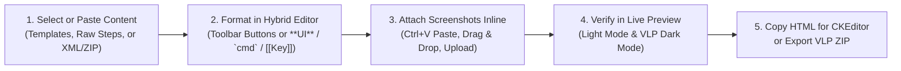

# VLP Manual HTML Formatter & XML Builder

A completely self-contained, air-gapped web application for authoring, standardizing, and packaging **VMware Lab Platform (VLP)** lab manuals. Converts raw text, draft notes, and legacy `content.xml` chapters into light-and-dark-mode compatible HTML5 snippets ready for VLP CKEditor (`</> Source` view) or complete VLP `.zip` archives (`content.xml` + `images/`)—natively with zero AI tools or internet access.

---

## Key Features

- **100% Native & Air-Gapped**: Deterministic formatting engine (`public/vlp-formatter.js`) with zero external CDNs, fonts, or AI dependencies.
- **Strict VLP Spec Compliance**: Implements the Master `<style>` block and layout rules from `vlp-manual-html-formatter.txt` (Course Overview `.course-overview`, Procedural Steps `.lab-wrapper`, Red Box rules for `.purpose-card` & `.lab-note`, and semantic inline tags).
- **Multi-Node XML & ZIP Package Support**: Navigate `Course Overview` → `Chapters` → `Step Pages`, import/export VLP `content.xml` or `.zip` packages, and consolidate legacy Word/CKEditor chapters in one click.
- **Pre-Made Templates & Live Button Guide**: Four ready-to-use templates plus a built-in **What Every Button Does** guide showing light/dark previews and HTML tags.
- **Dual Session Persistence**: Resists accidental tab/app closure using instant browser `IndexedDB` auto-save, debounced server disk persistence (`/data/sessions/autosave.json`), `navigator.sendBeacon` on tab hide/close, `beforeunload` protection, named snapshots, and `.json` project backups.

---

## Visual Interface Tour




---

## Interface Navigation Demo (Step-by-Step)

### 1. Top Action Bar

| Control | What It Does |
| --- | --- |
| **Saved (Browser & Disk)** badge | Confirms dual auto-save status (`IndexedDB` + server `/data/sessions/autosave.json`). |
| **Undo** | Reverts structural changes (adding/deleting nodes, applying templates, consolidating chapters). |
| **Templates & Button Guide** | Opens the 3-tab modal: **Pre-Made Templates**, **What Every Button Does**, and **Reference Manuals**. |
| **Load Annex B** / **Load Annex C** | Loads the bundled reference manuals (`dsac.annexb.lab01-en` end-goal example and `dsac.annexc.lab01-en` multi-chapter XML example). |
| **Sessions** | Save/restore named server snapshots or download/restore portable `.json` project backups. |
| **Import XML / ZIP** | Imports an existing VLP `content.xml` or `.zip` manual package (including `./images/*`). |
| **Export XML** / **Export VLP ZIP** | Downloads `content.xml` alone or a complete `<manual-name>-en.zip` containing `content.xml` and `images/`. |

---

### 2. Left Pane — Manual Structure Tree

Mirrors the hierarchical `content.xml` structure (`Manual` → `Chapters` → `Step Pages`):

1. Set the **Manual Package Name** (e.g., `dsac.annexb.lab01`) and **Language** (`en`).
2. Click **`+ Chapter`** to add a Level 1 chapter or **`+ Page`** to add a Level 2 procedural step page.
3. Click any node in the tree to edit it. Badges show each page's active format:
   - `OVR` — Course Overview / Introduction (`.course-overview`)
   - `STP` — Procedural Steps Table (`.lab-wrapper`)
   - `RAW` — Preserved Legacy / Imported HTML
4. Hover over a node to move it (`↑` / `↓`) or delete (`×`).

---

### 3. Center Pane — Hybrid Editor & Formatting Toolbar

#### Switch Page Layout Mode
Use the segmented control next to the node title:
- **Course Overview**: Structured builder for Course Title (`<h1>`), Banner Image, Overview paragraphs, optional `<hr class="section-divider" />`, **Instructional Purpose Card** (`.purpose-card`), and **Target VM Credentials Card** (`.lab-note`).
- **Procedural Steps**: Visual step-row builder (`.lab-table` with circular red `.step-badge` counters), optional **Step Context** (`What you are doing:` / `Why this matters:`), **Terminal Verification Output** (`.term-box`), and inline screenshots.
- **Raw / Imported**: Preserves imported/custom HTML verbatim until you click **Convert Page to Procedural Steps** or **Convert Page to Course Overview**.

#### Apply Semantic Tags (Toolbar or Explicit Markup)
Highlight text inside any editor field and click an inline toolbar button (or type the shortcut directly). Clicking the **`?`** next to any button opens a live Light/Dark demonstration of that element:

| Toolbar Button | HTML Output | Explicit Shortcut | Use For |
| --- | --- | --- | --- |
| **UI Target** | `<span class="ui-target">...</span>` | `**Text**` or `[ui]Text[/ui]` | Buttons, menus, window names, VM names |
| **Command** | `<code class="cmd-inline">...</code>` | `` `command` `` | CLI commands, tools (`gpedit.msc`, `whoami`), usernames, passwords |
| **Key Press** | `<kbd class="key-press">... </kbd>` | `[[Key]]` | Keyboard keys & shortcuts (`Enter`, `Windows Key + R`) |

> **Note:** Formatting is strictly deterministic—plain text is never auto-tagged unless you apply a toolbar button or explicit markup shortcut.

#### Convert Raw Text into Steps
In **Procedural Steps** mode, paste plain or numbered steps into **Raw Text → Procedural Steps Converter**:

```text
1. Click **Start**, type `gpedit.msc`, and press [[Enter]].
What you are doing: Opening the Local Group Policy Editor.
Why this matters: Group Policy controls Windows Server firewall and security baselines.
2. Run `whoami` to confirm the active administrative account.
```

Click **Replace Steps** or **Append Steps**—exact step wording is preserved, and `What you are doing:` / `Why this matters:` lines automatically populate `.step-context`.

#### Consolidate Legacy XML Chapters (Annex C Demo)
1. Click **Load Annex C** in the top bar.
2. Select any Level 1 Chapter node (such as `Configuring DCUI (Direct Console User Interface)`).
3. Click **Consolidate Chapter Steps into VLP Table** in the amber banner.
4. All child micro-steps are cleaned of Word/Office inline styles and zero-width characters, screenshots are mapped 1-to-1 inline inside step cells, and the chapter is standardized into a single `.lab-wrapper` table page.

#### Attach Screenshots Inline
- Focus a step's dropzone (or instruction textarea) and press **`Ctrl+V`** to paste from the clipboard, drag-and-drop an image file, or click to browse.
- Uploaded/pasted screenshots automatically receive a UUID filename (`./images/<uuid>.<ext>`), measure dimensions for `<images>` XML metadata, and persist on disk.

---

### 4. Right Pane — Live VLP Preview & Export

1. Toggle **Live VLP Preview**, **HTML (`</>` Source)**, or **Node XML** tabs.
2. Switch **Light Mode** ↔ **VLP Dark Mode** to verify contrast against VMware Clarity dark selectors.
3. Choose how images appear in copied HTML via **Copied HTML Images**:
   - `./images/<uuid>.png (VLP Standard)` — for VLP XML/ZIP manual packages
   - `Inline Base64 Data URI (Standalone)` — for standalone copy/paste directly into VLP CKEditor
4. Click **Copy VLP HTML** to copy the self-contained `<style>...</style>` + HTML container snippet.

---

## Quick Start & Air-Gapped Docker Deployment

### Option 1: Docker Compose (Recommended)

```bash
docker compose up -d
```

Open **`http://localhost:8080`** in your browser. Sessions and uploaded images persist across container restarts in `./data` (mounted to `/data` inside the container).

### Option 2: Air-Gapped Transfer (`docker save` / `docker load`)

On a build machine:
```bash
docker build -t vlp-manual-generator:latest .
docker save -o vlp-manual-generator.tar vlp-manual-generator:latest
```

On the air-gapped host:
```bash
docker load -i vlp-manual-generator.tar
docker run -d --name vlp-manual-generator -p 8080:8080 -v vlp_data:/data vlp-manual-generator:latest
```

### Option 3: Local Node.js & Automated Tests

```bash
npm install
npm test
npm start
```
